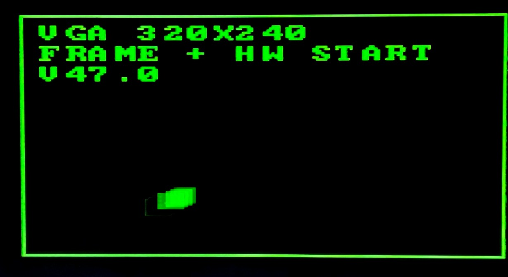
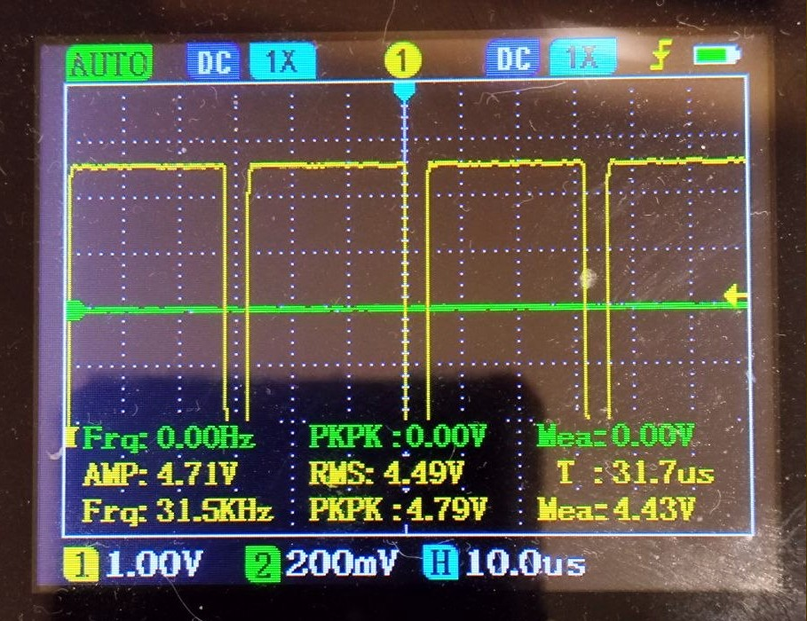
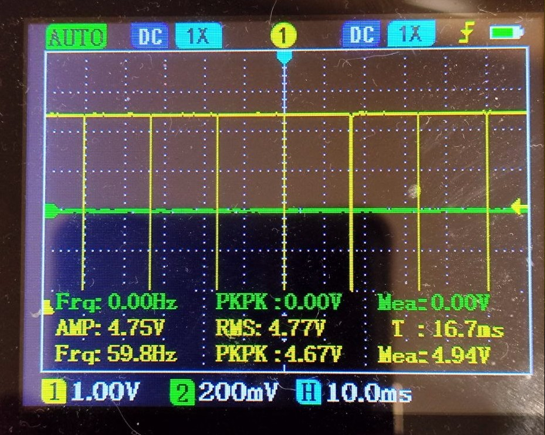

# UnoR4-VGA-V47

> **V47.0 — Public Release**
> A working standalone monochrome VGA demonstration for Arduino Uno R4 Minima.
> This is a complete project, not a packaged Arduino library.

Bare-metal VGA video engine for **Arduino Uno R4 Minima (Renesas RA4M1)**.

The project generates VGA-compatible raster timing using SPI1, DMA and GPT7 hardware synchronization. It includes a 320×240 monochrome graphics buffer and a demonstration with a moving square.

## Demo Video

<video src="media/video/vga_demo.mp4" controls width="640"></video>

If the video does not play inline, open it directly: [vga_demo.mp4](media/video/vga_demo.mp4).

## Display and Oscilloscope Traces

| VGA Display | HSync — D9 | VSync — D8 |
| :---: | :---: | :---: |
|  |  |  |

## Video Format: 320×240 and VGA 640×480

The engine generates VGA-compatible raster timing:

- 640×480 raster format;
- 525 total lines per frame;
- 480 active lines;
- approximately 31.475 kHz horizontal frequency;
- approximately 60 Hz vertical frequency.

The actual graphics buffer is **320×240 pixels**.

The distinction is important:

- **Horizontal:** 320 pixels of image data are prepared from VRAM. The line buffer contains additional zero-filled words.
- **Vertical:** the 240-line VRAM image window is placed inside the 480 active raster lines. Active lines outside this window contain no image data and appear black.
- The vertical synchronization interval is separate from the 480 active lines.

Therefore, 320×240 describes the graphics buffer, not the complete VGA raster format.

## Main Features

- **Bare-metal hardware control:** direct register access to SPI1, DMAC and GPT7.
- **SPI video output:** SPI1 operates at 24 MHz and outputs the monochrome video data through MOSI.
- **DMA scan-out:** DMA transfers prepared line-buffer data to SPI1, reducing CPU involvement during pixel transmission.
- **Hardware line start:** GPT7 compare-match event starts the first DMA transfer through DMAC1.
- **Graphics primitives:** horizontal span filling through `vram_hspan()` and rectangle drawing through `vram_fill_rect()`.
- **Built-in demonstration:** a 16×16 square moves inside the 320×240 graphics area.
- **V-Blank updates:** animation coordinates are updated during the vertical blanking interval to avoid visible tearing.

## Hardware Connections

See [hardware/README.md](hardware/README.md) for wiring details, VGA connector pinout and resistor recommendations.

| VGA Signal | Arduino Uno R4 Minima | Function |
| :--- | :---: | :--- |
| HSync | D9 | GPT7 hardware output |
| VSync | D8 | GPIO output |
| Green Video | D11 | SPI1 MOSI, 24 MHz |
| GND | GND | Common ground |

The project uses monochrome green video output. Follow the resistor recommendations in the hardware documentation.

## Firmware Installation

1. Open `firmware/v47_demo/v47_demo.ino` in Arduino IDE.
2. Select **Arduino Uno R4 Minima**.
3. Compile the sketch.
4. Upload it to the board.

## Button Controls

Buttons are active-low and use internal pull-up resistors.

| Button | Function |
| :---: | :--- |
| D2 | Increase line-start phase (BEG +) |
| D3 | Decrease line-start phase (BEG −) |
| D4 | Modifier/inhibit: while pressed, commands from the other buttons are blocked |
| D5 | Shift the horizontal image window left by one word (32 pixels) |
| D6 | Shift the horizontal image window right by one word (32 pixels) |

D5 and D6 move the horizontal image window in 32-pixel increments. The available range is controlled by the firmware.

## Current Limitations

- Monochrome video output.
- One graphics VRAM buffer; full-frame double buffering is not implemented.
- No keyboard or PS/2 input.
- Control is performed using the onboard buttons.
- The current release is a standalone demonstration sketch, not a reusable Arduino library.

## Possible Future Development

These features are not included in V47.0:

- RGB color output.
- Full-frame double buffering.
- Text mode.
- PS/2 keyboard support.
- Packaging as a reusable Arduino library.

## License

This project is distributed under the **Non-Commercial License with Attribution, Version 1.0**.

Personal and educational use, modification and redistribution are permitted under the conditions described in the [LICENSE](LICENSE) file.

The author, **alohachelny**, must be credited, and a link to this repository must be provided. Commercial use requires prior written permission from the author.

---

# Русская версия

> **V47.0 — публичный релиз**
> Рабочий самостоятельный демонстрационный проект монохромного VGA для Arduino Uno R4 Minima.
> Это законченный проект, но не оформленная Arduino-библиотека.

Монохромный VGA-видеодвижок с прямым управлением аппаратурой (bare-metal) для **Arduino Uno R4 Minima (Renesas RA4M1)**.

Проект формирует VGA-совместимую развёртку с использованием SPI1, DMA и аппаратной синхронизации GPT7. Видеобуфер содержит монохромное изображение 320×240 пикселей. В демонстрации используется движущийся квадрат.

## Демонстрационное видео

<video src="media/video/vga_demo.mp4" controls width="640"></video>

Если видео не воспроизводится прямо в окне, откройте файл: [vga_demo.mp4](media/video/vga_demo.mp4).

## Изображение и осциллограммы

| VGA-экран | HSync — D9 | VSync — D8 |
| :---: | :---: | :---: |
|  |  |  |

## Формат изображения: 320×240 и VGA 640×480

Движок формирует VGA-совместимую развёртку:

- формат развёртки 640×480;
- 525 строк на кадр;
- 480 активных строк;
- частота строчной синхронизации около 31,475 кГц;
- частота кадров около 60 Гц.

При этом фактический графический буфер имеет размер **320×240 пикселей**.

Важно различать размер изображения и полный формат видеосигнала:

- **По горизонтали:** из VRAM подготавливаются 320 пикселей изображения. В буфере строки также присутствуют дополнительные нулевые слова.
- **По вертикали:** окно изображения высотой 240 строк располагается внутри 480 активных строк развёртки. Активные строки за пределами этого окна не содержат данных изображения и отображаются чёрными.
- Интервал кадровой синхронизации находится отдельно от 480 активных строк.

Таким образом, 320×240 — это размер графического буфера, а не полный формат VGA-развёртки.

## Основные возможности

- **Bare-metal:** прямое управление регистрами SPI1, DMAC и GPT7.
- **Вывод через SPI:** SPI1 работает на частоте 24 МГц и передаёт монохромный видеосигнал через MOSI.
- **Вывод через DMA:** DMA передаёт подготовленные данные буфера строки в SPI1, уменьшая нагрузку на процессор во время передачи пикселей.
- **Аппаратный старт строки:** событие сравнения GPT7 запускает первую передачу DMA через DMAC1.
- **Графические примитивы:** заполнение горизонтальных участков через `vram_hspan()` и рисование прямоугольников через `vram_fill_rect()`.
- **Встроенная демонстрация:** квадрат 16×16 перемещается внутри графической области 320×240.
- **Обновление в V-Blank:** координаты анимации обновляются во время кадрового интервала гашения, чтобы избежать видимых разрывов изображения.

## Подключение

Подробная распиновка VGA, схема подключения и рекомендации по резисторам приведены в [hardware/README.md](hardware/README.md).

| Сигнал VGA | Arduino Uno R4 Minima | Назначение |
| :--- | :---: | :--- |
| HSync | D9 | Аппаратный выход GPT7 |
| VSync | D8 | Выход GPIO |
| Зелёный видеосигнал | D11 | SPI1 MOSI, 24 МГц |
| GND | GND | Общая земля |

В текущей версии используется монохромный зелёный видеосигнал. Номиналы резисторов выбирайте согласно рекомендациям в документации по подключению.

## Загрузка прошивки

1. Откройте `firmware/v47_demo/v47_demo.ino` в Arduino IDE.
2. Выберите плату **Arduino Uno R4 Minima**.
3. Скомпилируйте скетч.
4. Загрузите его в плату.

## Управление кнопками

Кнопки работают по активному низкому уровню; для входов используются внутренние подтягивающие резисторы.

| Кнопка | Функция |
| :---: | :--- |
| D2 | Увеличить фазу старта строки (BEG +) |
| D3 | Уменьшить фазу старта строки (BEG −) |
| D4 | Кнопка-модификатор/блокировка: при нажатии команды остальных кнопок блокируются |
| D5 | Сдвинуть горизонтальное окно изображения влево на одно слово (32 пикселя) |
| D6 | Сдвинуть горизонтальное окно изображения вправо на одно слово (32 пикселя) |

Кнопки D5 и D6 перемещают горизонтальное окно изображения с шагом 32 пикселя. Допустимый диапазон задаётся прошивкой.

## Текущие ограничения

- Только монохромный видеосигнал.
- Один графический буфер VRAM; полной двойной буферизации кадра нет.
- Нет клавиатуры и поддержки PS/2.
- Управление выполняется кнопками на плате.
- Текущий релиз представляет собой самостоятельный демонстрационный скетч, а не готовую библиотеку Arduino.

## Возможное развитие проекта

Следующие функции не входят в V47.0:

- Цветной RGB-видеосигнал.
- Полная двойная буферизация кадра.
- Текстовый режим.
- Поддержка клавиатуры PS/2.
- Оформление в виде переиспользуемой Arduino-библиотеки.

## Лицензия

Проект распространяется по лицензии **Non-Commercial License with Attribution, Version 1.0** (некоммерческая лицензия с указанием авторства).

Личное и учебное использование, изменение и распространение разрешены на условиях, изложенных в файле [LICENSE](LICENSE).

Необходимо указать автора — **alohachelny** — и приложить ссылку на репозиторий. Коммерческое использование возможно только с предварительного письменного разрешения автора.
